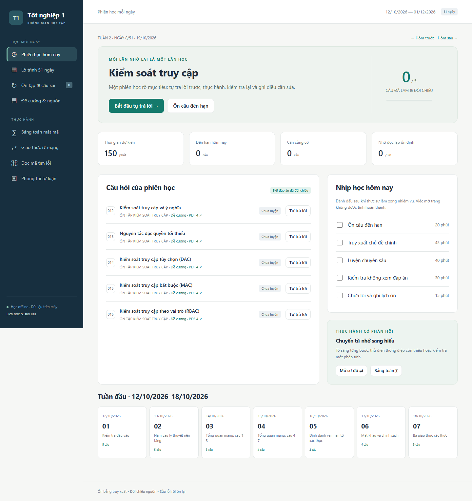
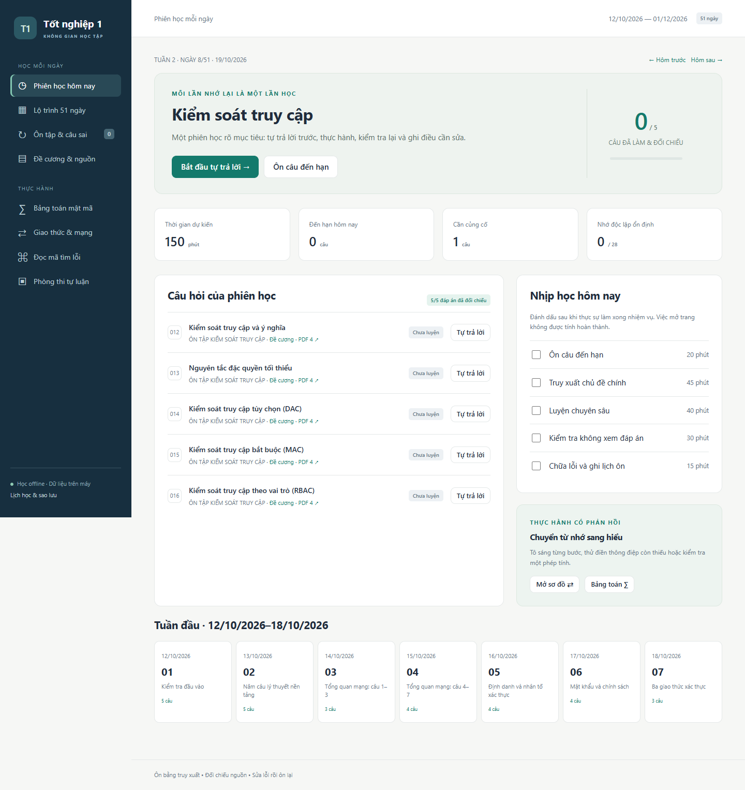
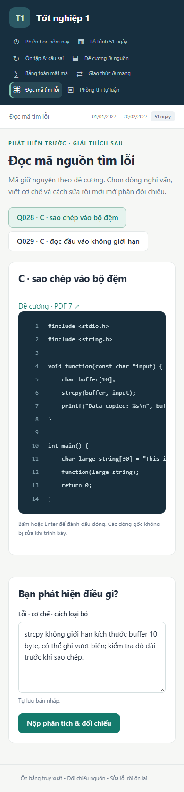
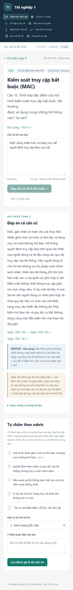
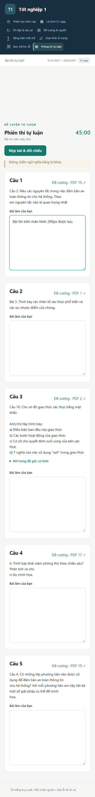

# Sửa lỗi reviewer và mốc học đến 19/10 — 11/10/2026

Baseline được review: `1b32c557f712bc2e3c61966ffb99990fa5f086c8`.
Mốc này sửa P0, bổ sung Q012–Q016 theo thứ tự lịch và kiểm kê mục con; **chưa nghiệm thu nội dung đủ 51 ngày**.

## Phạm vi

Đã hủy tính năng nhập đề cương mới; không còn trong roadmap/backlog. Nguồn cố định: slide + đề cương hiện có. Giữ xuất/khôi phục JSON tiến độ, dời lịch thủ công và cập nhật đáp án đã kiểm chứng. Không sửa Word/PDF gốc.

## Lỗi đã sửa

| Mức | Vấn đề | Sửa và chứng cứ |
|---|---|---|
| P0-A | Khôi phục không cập nhật phiên thi/thiết lập có sẵn | JSON v2 với thời điểm sửa thiết lập, đọc được v1; merge có kiểm tra định danh bất biến, thứ tự phiên bản và bài nộp. Bản cũ không ghi đè bản mới; xung đột hủy cả giao dịch. |
| P0-B | Debounce và kiểm tra giờ lúc xử lý làm rơi ý cuối | Gửi bản chụp ngay khi nhập; ghi giờ nhận đầy đủ phía máy chủ trước chờ DB; xếp FIFO các yêu cầu đã nhận. Hết giờ khóa nhập, chờ lưu rồi nộp; nộp lặp không tạo thêm bài. |
| P1 | Đóng tab trong 400 ms làm mất nháp | Nháp giữ ngay trong localStorage, phục hồi khi mở lại cùng profile; nháp chưa được máy chủ nhận đúng hạn tách khỏi bài thi đã nộp. |
| P1 | Hiển thị năm cố định sau dời lịch | Ngày đầy đủ lấy từ dữ liệu; kiểm thử dời sang 01/01/2027, cả ngày học, thanh ngày và dải tuần đầu. |
| P1 | 80 câu/150 phút ngày 51 | Ngày 51 chọn 8 câu, giữ 150 phút và thống kê ngân hàng 80/43 riêng. Ngày 42 cũng chọn 8 câu. |
| P1 | Khung mã tràn màn hình 390 px | Giới hạn kích thước tối thiểu phần tử grid; cuộn trong khung mã, giữ nguyên dòng nguồn. |
| P1 | Mở app dùng lại máy chủ cũ chỉ vì SHA slide giống | Launcher so fingerprint của mã/ngân hàng/giao diện với bản được nạp; chỉ dùng lại bản khớp, dừng PID đã xác minh khi cần cập nhật; chờ tiến trình dừng. Giao diện báo rõ khi máy chủ chưa cập nhật. |

### Quy tắc merge cụ thể

- Một giao dịch `BEGIN IMMEDIATE`; bản sai cấu trúc/ID/trạng thái hoặc xung đột hủy toàn bộ.
- Phiên thi giữ nguyên ID, đề, giờ bắt đầu, deadline. Bản nộp kết thúc phiên; bản đang làm cũ không mở lại bài nộp. Hai bản nộp khác nội dung/thời điểm/ID bài ôn bị từ chối. Bản nộp cũ hơn bản đang làm bị từ chối.
- Phiên đang làm so số phiên bản, rồi thời điểm sửa; cùng thứ tự nhưng khác nội dung bị báo xung đột. V1 thiếu metadata không được suy đoán là mới hơn.
- Lịch/thiết lập/nháp giữ thời điểm sửa mới hơn. Thiết lập v1 không có thời điểm chỉ tạo khóa chưa có. Bài làm theo ID giữ dữ liệu gốc, cập nhật phần đánh giá mới hơn; thực hành theo ID. Không dùng REPLACE để ghi đè tất cả.

### Giờ thi và phần chưa gửi

Giới hạn chấm là **thời điểm máy chủ nhận đầy đủ yêu cầu**, không tin timestamp của trình duyệt. Yêu cầu nhận trước hạn dù chờ DB qua giờ vẫn được lưu; yêu cầu đến đúng/sau hạn không sửa bài. Đồng hồ hiển thị dùng giờ máy chủ và thời gian trôi đơn điệu. “Đã lưu trên máy chủ” xác nhận ghi SQLite.

Không thể chứng minh giờ gõ khi máy chủ chưa nhận. Phần chưa gửi/đến muộn được giữ trong nháp phục hồi **không tính vào bài đã nộp**, để không mất văn bản và không nhận sửa sau giờ. Nháp trình duyệt chưa xác nhận chưa nằm trong JSON máy chủ; cần giữ profile trình duyệt đến khi phục hồi. Đây là giới hạn được thông báo trong giao diện, không giả nhận nội dung offline là bài nộp đúng hạn.

## Kiểm thử

| Kiểm tra | PASS | FAIL | SKIP |
|---|---:|---:|---:|
| unittest (giữ nguyên 24 test cũ, thêm 9 test) | 33 | 0 | 0 |
| Audit kho nguồn | 1 | 0 | 0 |
| Playwright, 11 nhóm hành trình/kiểm tra | 11 | 0 | 0 |
| SHA của 3 PDF + Word gốc | 4 | 0 | 0 |
| Giao diện máy chủ thật sau cập nhật, GET-only | 1 | 0 | 0 |

Đã chạy `python -m unittest discover -s tests -v`, `python tools/study.py audit`, `node tools/browser_check.cjs`. [Log unittest](assets/reviewer-fixes/unit-tests.txt), [audit](assets/reviewer-fixes/source-audit.json), [log trình duyệt và dữ liệu chứng minh](assets/reviewer-fixes/browser-report.json).

[Log đỏ trước sửa](assets/reviewer-fixes/p0-before.txt): cả 3 test tái hiện đều FAIL đúng lỗi (bài nộp không cập nhật, ý cuối biến thành `{}`, bản xung đột không bị hủy). Sau sửa cả 3 PASS; thêm kiểm thử thiết lập mới/cũ/v1, phiên bản out-of-order, nộp lặp, xung đột bài nộp và các bất biến nội dung.

**P0-A trong trình duyệt:** bản cũ chứa A; nhập thêm B và nộp; khôi phục bản mới vào DB chứa bản cũ, sau đó lại khôi phục bản cũ. Kết quả một phiên đã nộp, đủ A+B, số bài làm không tăng trùng.

**P0-B với đồng hồ giả:** fixture nhận yêu cầu lúc 10:44:55, hạn 10:45:00; chặn worker đến khi giao diện về 00:00 và giờ máy chủ là 10:45:01. Sau mở chặn, ý cuối xuất hiện trong bài nộp và sau tải lại. Yêu cầu sửa sau hạn không đổi nội dung; nộp lại không tăng số bài. unittest kiểm thêm giờ nhận trước hạn 100 ms nhưng xử lý sau hạn 900 ms. Đồng hồ/cổng chặn chỉ tồn tại ở fixture, không có API chỉnh giờ trong sản phẩm.

Playwright dùng DB/profile/cổng riêng; thử đóng tab trước debounce, đóng cả trình duyệt rồi mở profile, chuyển ngày, xuất/khôi phục JSON qua giao diện, dừng và khởi động máy chủ (so toàn bộ 6 bảng), nháp mất kết nối tách khỏi bài nộp. Kiểm tra KaTeX, điểm ECC SVG, tô sáng/ẩn/điền sơ đồ, dòng mã, rubric, câu sai; toàn bộ các màn hình chính ở 390 px và 1440 px. Không có lỗi JavaScript hay yêu cầu tài nguyên ngoài localhost. Script và fixture được commit để chạy lại; cấu hình trong [hướng dẫn](../study_app/README.md).

Máy chủ học thật đã nạp 28 câu; đối chiếu trạng thái trước/sau cho thấy dữ liệu học giữ nguyên. Bản sao an toàn của SQLite thật nằm cục bộ `.qa/`, không đưa dữ liệu cá nhân vào Git. Ảnh dưới từ kiểm thử, trừ ảnh live có ghi riêng; không dùng thành tích QA làm tiến độ học thật.

## Nội dung đã bổ sung

28/80 câu chính có đáp án/rubric đầy đủ: Q001–016, Q032–036, Q068–074. Phiên ngày 8 (19/10) đủ 5/5 đáp án.

| Câu | Căn cứ PDF slide | Phần vận dụng |
|---|---|---|
| Q012 | 149–150 | Ý nghĩa theo CIA, ví dụ đọc/sửa điểm |
| Q013 | 148 | Phân tích quyền cần/thừa và giảm hậu quả |
| Q014 | 154–157, 162 | Lý do phù hợp chia sẻ theo owner; hạn chế ACM từ 156 |
| Q015 | 164–165, 167 | Chính sách thống nhất, ví dụ mức/hạng mục/thao tác |
| Q016 | 148, 170–171 | Hệ thống phù hợp, vai trò phòng đào tạo/sinh viên, quyền kiêm nhiệm |

Đã xem trực quan trang 148–150, 154–158, 162, 164–168, 170–171; không sửa nhãn kiểm chứng trong kho trích xuất. Mỗi thẻ giữ câu hỏi nguyên văn, đoạn chứng cứ cùng SHA, 2 cấp gợi ý và rubric. Vận dụng được ghi DERIVED riêng. Q015 ghi chú nghi vấn dấu `>` ở 166 so với sơ đồ 168, không tự áp công thức đó cho mọi thao tác. Reviewer Chat cần kiểm tra chất lượng học thuật độc lập; không có chấm ngữ nghĩa tự luận tự động.

### 43 mục con

Kiểm kê đúng 43/43 theo `parent_question_id`, nguyên văn và yêu cầu/bước: [ma trận mục con](../study_app/content/child_coverage.csv).

- 12 REVIEWED: a–d của Q009, Q010, Q011; từng mục trỏ rubric r1–r4 của câu cha và trang chứng cứ.
- 6 PRACTICE_READY_PARTIAL: a–b Q046 và a–d Q048. Không gọi là hoàn chỉnh; riêng mã hóa/giải mã/kiểm chứng và ba khóa công khai được liệt kê để không quên yêu cầu.
- 25 AWAITING_REVIEW. Q048-d giữ thiếu ánh xạ số sang điểm; Q049-a/b/c giữ lỗi miền “mod 1”. Không tự thay dữ kiện.

### Bao phủ theo ngày

“Đủ” dưới đây là đáp án/rubric đã kiểm chứng, không tính thực hành một phần. Số mục con 0/0 nghĩa ngày đó không có mục con được tách trong đề, không phải bỏ sót. [CSV đủ mã đang thiếu từng ngày](../study_app/content/day_coverage.csv), [80 câu chính](../study_app/content/coverage.csv).

| Ngày | Ngày gốc | Câu chính đủ/tổng | Mục con đủ/tổng |
|---:|---|---:|---:|
| 1 | 2026-10-12 | 5/5 | 4/4 |
| 2 | 2026-10-13 | 5/5 | 0/0 |
| 3 | 2026-10-14 | 3/3 | 0/0 |
| 4 | 2026-10-15 | 4/4 | 0/0 |
| 5 | 2026-10-16 | 4/4 | 0/0 |
| 6 | 2026-10-17 | 4/4 | 0/0 |
| 7 | 2026-10-18 | 3/3 | 12/12 |
| 8 | 2026-10-19 | 5/5 | 0/0 |
| 9 | 2026-10-20 | 0/2 | 0/0 |
| 10 | 2026-10-21 | 0/1 | 0/0 |
| 11 | 2026-10-22 | 0/1 | 0/0 |
| 12 | 2026-10-23 | 0/3 | 0/0 |
| 13 | 2026-10-24 | 0/4 | 0/0 |
| 14 | 2026-10-25 | 0/1 | 0/0 |
| 15 | 2026-10-26 | 0/1 | 0/0 |
| 16 | 2026-10-27 | 0/1 | 0/0 |
| 17 | 2026-10-28 | 0/3 | 0/0 |
| 18 | 2026-10-29 | 0/2 | 0/0 |
| 19 | 2026-10-30 | 0/3 | 0/0 |
| 20 | 2026-10-31 | 0/4 | 0/4 |
| 21 | 2026-11-01 | 0/4 | 0/4 |
| 22 | 2026-11-02 | 0/3 | 0/2 |
| 23 | 2026-11-03 | 0/1 | 0/4 |
| 24 | 2026-11-04 | 0/1 | 0/4 |
| 25 | 2026-11-05 | 0/1 | 0/4 |
| 26 | 2026-11-06 | 0/1 | 0/3 |
| 27 | 2026-11-07 | 0/2 | 0/0 |
| 28 | 2026-11-08 | 0/5 | 0/4 |
| 29 | 2026-11-09 | 12/12 | 0/0 |
| 30 | 2026-11-10 | 16/16 | 12/12 |
| 31 | 2026-11-11 | 0/9 | 0/0 |
| 32 | 2026-11-12 | 0/3 | 0/0 |
| 33 | 2026-11-13 | 0/7 | 0/0 |
| 34 | 2026-11-14 | 0/11 | 0/10 |
| 35 | 2026-11-15 | 0/5 | 0/7 |
| 36 | 2026-11-16 | 0/5 | 0/6 |
| 37 | 2026-11-17 | 0/5 | 0/6 |
| 38 | 2026-11-18 | 0/5 | 0/4 |
| 39 | 2026-11-19 | 0/5 | 0/4 |
| 40 | 2026-11-20 | 0/5 | 0/4 |
| 41 | 2026-11-21 | 0/5 | 0/4 |
| 42 | 2026-11-22 | 3/8 | 0/4 |
| 43 | 2026-11-23 | 7/10 | 8/8 |
| 44 | 2026-11-24 | 0/11 | 0/10 |
| 45 | 2026-11-25 | 0/4 | 0/7 |
| 46 | 2026-11-26 | 4/6 | 12/12 |
| 47 | 2026-11-27 | 0/6 | 0/0 |
| 48 | 2026-11-28 | 3/5 | 4/4 |
| 49 | 2026-11-29 | 3/5 | 4/4 |
| 50 | 2026-11-30 | 3/5 | 4/4 |
| 51 | 2026-12-01 | 4/8 | 4/4 |

## Phần còn lại

52 câu chưa có đáp án tự luận đầy đủ: Q017–031, Q037–067, Q075–080 (trong đó 7 câu có hỗ trợ thực hành một phần). Tiếp tục theo lịch Q017–018 ngày 20/10, rồi Q019 và Q020. Chưa đủ 8 RSA, 3 ElGamal, 2 ECC, 1 DH, 2 ECDH theo mọi ý; chưa hoàn thiện bài giải giấy thi và rubric cho cả ba đề mẫu. PHP/XSS/SQL Injection, Snort/iptables, ESP Transport/Tunnel còn chờ đối chiếu và mở rộng giao diện. Không tạo đáp án để tăng coverage.

Chưa nghiệm thu toàn bộ lộ trình. Kiểm thử cơ chế lưu/thi đã đạt; kiểm chứng nội dung các ngày sau vẫn còn công việc. Không có phần QA bắt buộc nào bị SKIP trong mốc này.

## Ảnh nghiệm thu

Ảnh bổ sung: [nhớ lại/rubric](assets/reviewer-fixes/recall.png), [ECC](assets/reviewer-fixes/ecc.png), [sơ đồ](assets/reviewer-fixes/diagram.png), [bài nộp giữ ý cuối](assets/reviewer-fixes/deadline-preserved.png), [ngày 51 chọn lọc](assets/reviewer-fixes/final-selective.png).

## SHA nguồn giữ nguyên

- `CSATTT_SLIDE_FULL.pdf`: `75e22524b318039d960b72339afed37b56b492e94d60e5f1e03aada2ddfe7ec6`
- `Thông tư-09-2020-TT-NHNN .pdf`: `877afd9336574a2c0077a1d247587973458590d1b9fee5226ce445d9228cc20e`
- `Đề cương HPTTN1.pdf`: `7814c8ba2ca321647cc6e575b29744c25a305a15920ef9d2bd560f8179b35739`
- `Giai_de_cuong.docx`: `b43705f8430ed6a4b18e4da7ea8f4e410049f992c6aa6c0bf5359ac5d3c15ed3`
