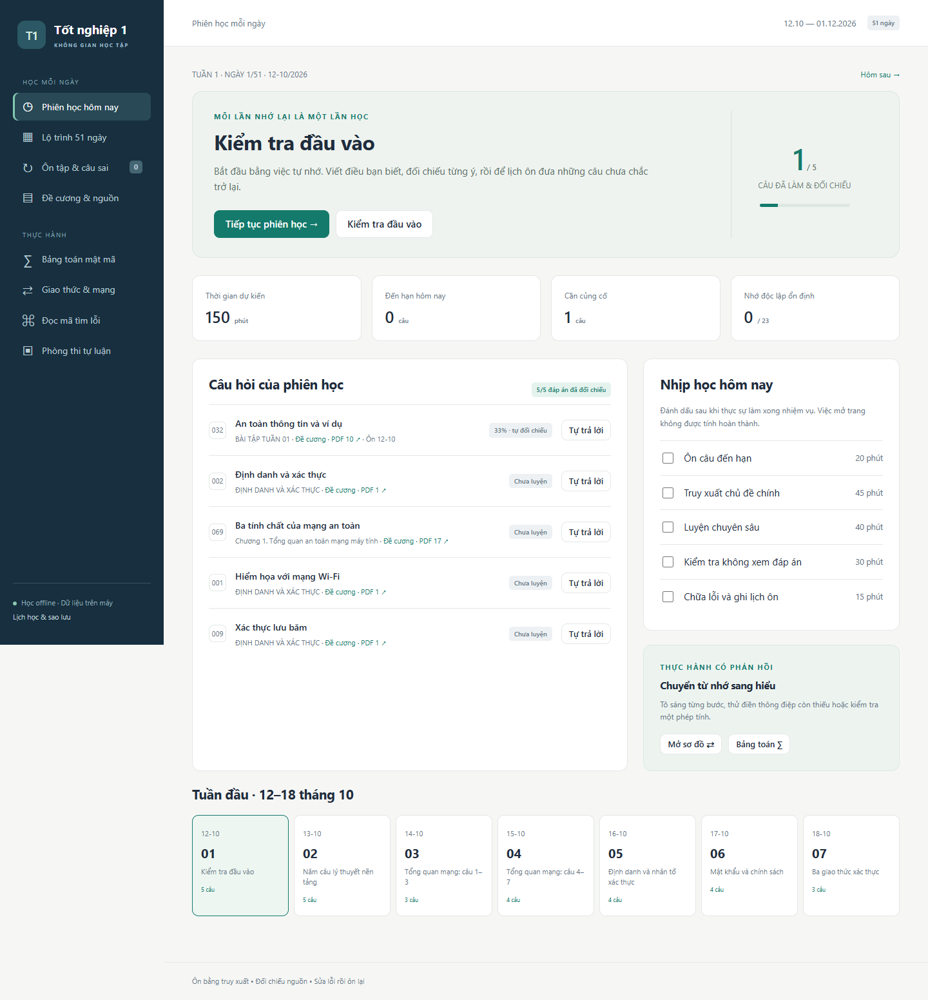

# Nghiệm thu mốc học được tuần đầu — 11/10/2026

**Kết luận:** đã có ứng dụng localhost hoạt động, đủ luồng học tuần đầu. Chưa nghiệm thu đáp án cho đủ 51 ngày. Dữ liệu kiểm thử được tách khỏi tiến độ học thật.

## Kiểm kê trước triển khai

| Nguồn | Kích thước | Vai trò |
|---|---:|---|
| `CSATTT_SLIDE_FULL.pdf` | 18.724.595 byte, 497 trang | Căn cứ học thuật chính |
| Đề cương HPTTN1 PDF | 1.494.574 byte, 18 trang | 80 câu chính, 43 mục con; nguyên văn và dữ kiện |
| `Giai_de_cuong.docx` | 1.399.125 byte | Bản giải hỗ trợ, không tự động coi là đáp án chuẩn |
| Thông tư 09/2020 PDF | 7.845.571 byte | Chỉ dùng khi câu hỏi liên quan trực tiếp; chưa dùng làm đáp án tuần 1 |

Audit nguồn trước/sau triển khai: `ok: true, errors: []`. Không sửa `knowledge/` hoặc logic truy xuất. Ngân hàng mới giữ toàn bộ bản ghi câu gốc bằng đối chiếu bình đẳng với JSONL hiện có, không thay mapping ứng viên thành nguồn đã xác minh.

SHA-256:

- Slide: `75e22524b318039d960b72339afed37b56b492e94d60e5f1e03aada2ddfe7ec6`
- Đề cương: `7814c8ba2ca321647cc6e575b29744c25a305a15920ef9d2bd560f8179b35739`
- Word: `b43705f8430ed6a4b18e4da7ea8f4e410049f992c6aa6c0bf5359ac5d3c15ed3`

Word được so SHA với bản Git trước triển khai (`96527d7`): giống hoàn toàn. Ba PDF gốc không thay đổi. Không thao tác ghi vào các tài liệu này.

## Nội dung đã đối chiếu

23 câu lý thuyết: Q001–011, Q032–036, Q068–074. Có đáp án, rubric, 2 gợi ý, nguồn từng trang và chú thích phần vận dụng. Ma trận chi tiết: [`study_app/content/coverage.csv`](../study_app/content/coverage.csv); câu hỏi, rubric và đoạn chứng cứ: [`bank.json`](../study_app/content/bank.json).

60 trang PDF slide dùng cho các đáp án trên đã xem bằng hình ảnh:

30, 36–40, 52, 57, 59–64, 66, 68–69, 71–73, 75–78, 108, 110, 112–115, 118, 121–122, 125–127, 129, 131–136, 139–142, 330–338, 364–365, 375, 378.

Bài đọc mã còn đối chiếu slide 303, 307, 311–313. Các trang đề cương 1–3, 7–16 được xem để đối chiếu sơ đồ, đoạn mã, số liệu mật mã và đề mẫu. Không tuyên bố đã xác minh toàn bộ 497 trang.

Ví dụ Wi-Fi, phân tích công nghệ/chính sách/con người, cách bố trí mạng và các tình huống vận dụng ghi `DERIVED`. Các thuật toán số học có nguồn bổ sung `EXTERNAL`; không gán công thức RSA/ECC chi tiết cho một trang slide không chứa chúng. Các điểm thiếu dữ kiện giữ nguyên và có thông báo.

## Chức năng đã chạy thử thật

| Kiểm tra | Kết quả |
|---|---|
| Câu hỏi hiện trước, đáp án ẩn; viết bài rồi nộp | PASS |
| Đối chiếu rubric, lưu điểm tự chấm, ý thiếu và lịch ôn | PASS |
| Tải lại trang vẫn giữ tiến độ; câu sai vào sổ ôn | PASS |
| RSA bộ số đề: C=280; ECC 6G=(7,9), đồ thị điểm | PASS |
| Ẩn/tô sáng sơ đồ, điền h(P_A), lưu kết quả | PASS |
| Chọn dòng strcpy và viết cơ chế trước khi mở giải thích | PASS |
| Thi đầu vào: đồng hồ, tự lưu, tải lại vẫn có bài, nộp mở rubric | PASS |
| Mở lộ trình, ngày 7, ngày 51, ngân hàng, lịch/sao lưu | PASS |
| Giao diện 1440px và 390px: không tràn ngang toàn trang | PASS |
| Không yêu cầu mạng ngoài khi chạy các luồng học | PASS · 0 request ngoài localhost |
| Trình duyệt không có lỗi JavaScript hoặc lỗi tải tài nguyên | PASS |
| Dừng/khởi động lại server kiểm thử | PASS · còn 8 bài tự luận, 16 lần thực hành, 4 phiên thi của dữ liệu thử |
| Xuất/khôi phục JSON; không tạo bản ghi trùng | PASS |
| Từ chối Origin/Host lạ, truy cập vượt thư mục và dữ kiện sai | PASS |
| Mở/dừng/mở bằng launcher Windows | PASS |

**24 kiểm thử tự động qua**: 11 kiểm thử kho truy xuất hiện có + 13 kiểm thử ứng dụng. Nhóm ứng dụng kiểm tra nguyên văn/nguồn, lịch 51 ngày, phủ tuần 1, ẩn đáp án, các vector số học, luật nhóm ECC, vô cực, tham số sai/thiếu, bậc lịch ôn, gợi ý/sai/tự tin thấp, không tăng thành thạo trong cùng ngày, lưu bền vững, chấm một lần, khôi phục hợp nhất và từ chối bản sao chứa mã/giá trị HTML.

Trong kiểm thử trình duyệt, rubric được cố ý đánh thiếu ý để kiểm tra luồng câu sai; đó không phải điểm học của người dùng. Cơ sở dữ liệu học thật nằm riêng ở `%LOCALAPPDATA%\ON_THI_TN1`.

## Reviewer kiểm tra trong 5 phút

1. Mở `MO_UNG_DUNG.cmd` hoặc `python -m study_app.server --port 8766 --data-dir .qa/reviewer`.
2. Ngày 1 → **Bắt đầu tự trả lời**. Viết bài, nộp. Chỉ đánh dấu một ý rồi lưu; phải có ý thiếu và ngày ôn.
3. Tải lại ứng dụng, mở **Ôn tập & câu sai**. Bài cũ và lỗi phải còn. Mở lại câu để tự trả lời lần mới.
4. **Bảng toán**: RSA giữ p=17,q=31,e=7,m=32; chọn tự giải, nhập 280. ECC giữ dữ kiện, k=6, nhập 7,9; phải có các điểm F11 và kết quả đúng.
5. **Giao thức**: ẩn thông điệp, bước tiếp, nhập h(P_A) rồi kiểm tra. **Đọc mã**: chọn dòng strcpy, viết cơ chế rồi nộp.
6. **Phòng thi**: bắt đầu kiểm tra đầu vào; viết câu đầu, đợi báo đã lưu, tải lại, nộp. Đáp án/rubric chỉ mở sau nộp.
7. **Lịch & sao lưu**: xuất JSON, khôi phục, dời lịch. Không được xóa bài cũ. Thử dừng và mở lại launcher.

```powershell
python -m unittest discover -s tests -v
python tools/study.py audit
```

Đối chiếu ngẫu nhiên câu lý thuyết theo các liên kết PDF và đoạn chứng cứ; reviewer vẫn cần đánh giá chất lượng đáp án học thuật độc lập. Không có bộ chấm tự luận hiểu ngữ nghĩa: lý thuyết/thi sử dụng tự đối chiếu rubric.

## Phần chưa hoàn tất

- 23/80 mục có đáp án lý thuyết đầy đủ trong thẻ; 7 mục khác có thực hành hỗ trợ một phần. Các mục còn lại có câu gốc và lịch, đáp án vẫn `UNVERIFIED`.
- Ba đề mẫu gốc lưu được bài nhưng chưa có đầy đủ rubric đã kiểm chứng; không cho điểm giả.
- Chưa phủ hết yêu cầu RSA/ElGamal/ECC; chưa có bài PHP/XSS, Snort/iptables và sơ đồ VPN/IPsec hoàn chỉnh.
- Sao lưu thủ công, chưa tự đồng bộ giữa máy. Các liên kết nguồn ngoài cần mạng khi mở; bài học, công thức và phép tính không cần mạng.

## Các file sản phẩm

- `MO_UNG_DUNG.cmd`, `DUNG_UNG_DUNG.cmd`: mở/dừng trên Windows.
- `study_app/server.py`, `math_engine.py`: lưu SQLite và số học chính xác.
- `study_app/static/`: giao diện, KaTeX/font cục bộ, SVG tương tác và hình đề gốc.
- `study_app/build_content.py`, `content/`: ngân hàng và ma trận/lịch.
- `tests/test_study_app.py`: kiểm thử các bất biến quan trọng.
- `study_app/README.md`, báo cáo này, README gốc: hướng dẫn và tình trạng nghiệm thu.


